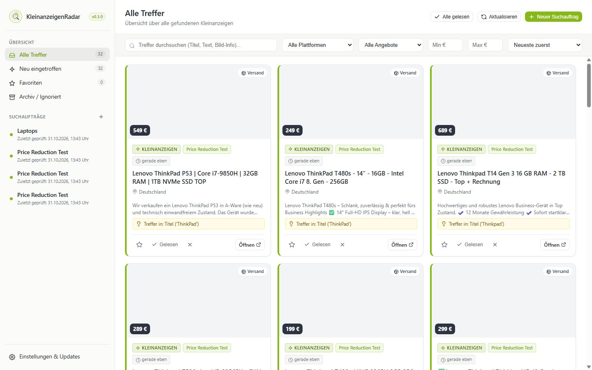
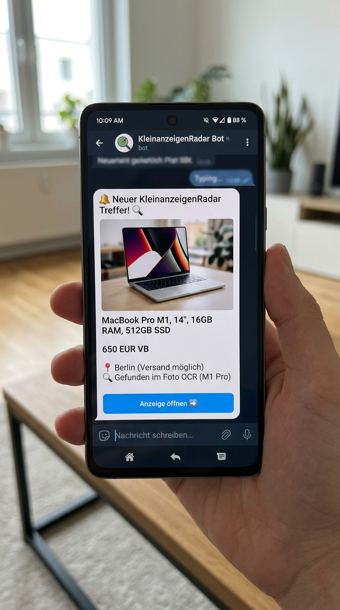

# KleinanzeigenRadar

<p align="center">
  
</p>

<p align="center">
  <b>Dein persönlicher, unermüdlicher Wächter für Kleinanzeigen</b><br>
  Läuft rund um die Uhr leise auf deinem Linux-System oder im Docker-Container – sowohl auf Standard-PCs (x86) als auch auf sparsamen Geräten wie dem Raspberry Pi (ARM).
</p>

<p align="center">
  
  
  
  
  
</p>

---

## 1-Befehl-Installation (Empfohlen)

Kopiere diesen **einzigen Befehl** in das Terminal deines Linux-Servers oder Raspberry Pis. Das Skript prüft alle Voraussetzungen, installiert fehlende Werkzeuge (inklusive Docker & Compose, falls noch nicht vorhanden) vollautomatisch, sucht selbstständig freie Ports und richtet die lokale Domain sowie HTTPS ein:

```bash
bash -c "$(curl -fsSL https://raw.githubusercontent.com/loe17/KleinanzeigenRadar/main/install.sh || wget -qO- https://raw.githubusercontent.com/loe17/KleinanzeigenRadar/main/install.sh)"
```

*Alternativ über Git-Klon:*
```bash
git clone https://github.com/loe17/KleinanzeigenRadar.git && cd KleinanzeigenRadar && ./install.sh
```

Nach der Installation ist KleinanzeigenRadar sofort über dein lokales Netzwerk erreichbar:
* **HTTPS:** `https://kleinanzeigenradar.local:8443` (oder `https://deine-server-ip:8443`)
* **HTTP:** `http://kleinanzeigenradar.local:8000` (oder `http://deine-server-ip:8000`)

---

## Einblicke in die Anwendung

### Das Dashboard
Schlicht, fokussiert und ohne Ablenkung mit gestochen scharfen SVG-Grafiken und zweisprachiger Benutzeroberfläche (Deutsch & Englisch). Alle Treffer laufen zentral ein und lassen sich blitzschnell nach Status, Versandart oder Preisspanne filtern:

<p align="center">
  
</p>

---

### Blitzschnelle Benachrichtigungen auf dein Smartphone
Sobald ein passendes Angebot online geht, erhältst du sofort eine Benachrichtigung auf dein Smartphone via **Telegram** (mit Bild, Preis und Klick-Link) oder per **E-Mail**:

<p align="center">
  
</p>

---

## Was kann KleinanzeigenRadar für dich tun?

Normale Suchen auf Kleinanzeigen sind oft ungenau oder verpassen Schnäppchen, weil Verkäufer wichtige Details im Text vergessen oder Tippfehler machen. **KleinanzeigenRadar** findet diese Angebote trotzdem:

* **Lokale Domain & HTTPS:** Direkt im Heimnetzwerk unter `https://kleinanzeigenradar.local` mit automatisch generiertem SSL-Zertifikat erreichbar.
* **Automatische Port-Erkennung:** Sollte ein Standardport (z. B. 8000 oder 8443) bereits durch andere Dienste belegt sein, sucht das System vollautomatisch den nächsten freien Port.
* **Live-Suchfortschritt & Ladeleiste:** Bei jedem manuellen Start oder Aktualisieren eines Suchauftrags visualisiert ein animierter Ladebalken (0–100%) über der Trefferliste den aktuellen Status, den Fortschritt und die Anzahl gefundener Inserate in Echtzeit.
* **Echtzeit-Treffer-Streaming:** Gefundene Inserate werden sofort beim Erkennen einzeln in der Datenbank gesichert und erscheinen ohne Wartezeit direkt live auf deiner Oberfläche.
* **ODER-Syntax (|) für flexible Alternativen:** Mit dem senkrechten Strich (`|`) kannst du beliebig viele Synonyme und Varianten in einem Begriff definieren (z. B. `Laptop | Notebook`, `Sofa | Couch`, `15*" | 17*"` oder `defekt | schaden`). Mindestens einer der Begriffe genügt für einen Treffer.
* **Interaktive Such-Infobox mit Beispielen (i):** Ein Klick auf das dezente (i)-Symbol im Suchauftrags-Fenster öffnet eine übersichtliche Anleitung mit praxisnahen Beispielen für ODER-Verknüpfungen, Joker-Sterne, Maßeinheiten und Ausschlussbegriffe.
* **Erweiterte Teilwort- & Einheitensuche (`*16*GB`):** Intelligente Wortteil-Suche mit automatischer Leerzeichen- und Einheitentoleranz. Suchbegriffe wie `*16*GB` finden `16GB`, `16 GB`, `16-GB`, `RAM: 16 GB` und `16 GB RAM` gleichermaßen.
* **Intelligente Displaygrößen-Erkennung (`15*"`, `15"`, `Zoll`, `Inch`):** Suchst du nach `15*"`, erkennt das System automatisch alle gängigen Schreibweisen wie `15,6 Zoll`, `15 Zoll`, `15-Zoll`, `15"`, `15.6"` oder `15 inch` – ohne dass du jede Variante einzeln anlegen musst.
* **Synonym-Erkennung (`Laptop` / `Notebook`):** Bei der Suche nach `Laptop` oder `Laptops` werden Inserate mit `Notebook` oder `Notebooks` automatisch als vollwertiger Treffer gewertet und umgekehrt.
* **Mehrseiten-Scraping für maximale Treffer:** Scannt bei Suchläufen mehrere Ergebnisseiten auf Kleinanzeigen ab, sodass auch bei beliebten Kategorien mit hunderten Angeboten keine Schnäppchen übersehen werden.
* **Strikte Preisgrenzen-Sicherheit:** Garantiert, dass Treffer stets innerhalb der definierten Mindest- und Maximalpreisgrenzen deines Suchauftrags liegen, auch wenn die Filterleiste im Dashboard zurückgesetzt wird.
* **Präzise Treffer-Aufschlüsselung:** Zeigt dir genau an, was wo gefunden wurde (z. B. `Titel ('Lenovo', 'T480') • Beschreibung: '16' (...16 GB RAM...)`), inklusive relevantem Textausschnitt.
* **Vollständige Beschreibung & Fotogalerie per Klick:** Mit einem Klick auf die Anzeige öffnet sich sofort das Detailfenster mit der vollständigen Artikelbeschreibung und vergrößerbaren Originalfotos. Zusätzlich zeigt die Karte eine 2-zeilige Textvorschau.
* **Online-Dauer & Preisverlauf:** Erkennt transparent, wie lange Inserate schon online sind (`vor 2 Std.`, `Heute, 14:23`) und dokumentiert Preissenkungen mit durchgestrichenem Altpreis und Ersparnis (`~~200 €~~ 160 € (-40 €)`). Im Detailfenster siehst du den gesamten Preisverlauf.
* **E-Mail-Vorlagen & SSL/TLS-Unterstützung:** Vorkonfigurierte Vorlagen für Netcup (Port 465 SSL & Port 587 STARTTLS), Gmail, Outlook, GMX, WEB.DE, 1&1/IONOS und Strato. Volle Unterstützung für direktes SSL/TLS (Port 465) und STARTTLS (Port 587) mit klarer Fehlerdiagnose.
* **Live-Treffer Vorschau beim Eintippen:** Während du Suchbegriffe, Preisbereiche oder Postleitzahlen eingibst, ermittelt das System in Sekundenschnelle die aktuelle Trefferanzahl direkt bei Kleinanzeigen und zeigt sie live an.
* **Flexible Such- & Ausschlussbegriffe mit Sternchen-Joker (*):** Kein starrer Hauptbegriff mehr. Du kannst beliebig viele Begriffe (z. B. `Dell Latitude`, `Lenovo T480`) hinterlegen und frei bestimmen, ob sie als aktiver Suchbegriff (grün) oder Ausschlussbegriff (rot) dienen. Mit Sternchen wie `*15*` findest du Begriffe auch innerhalb von Wörtern (z. B. `15Zoll` oder `XPS15`), mit `15*` am Wortanfang oder mit `*defekt*`, um auch Teilwörter wie `Teildefekt` auszuschließen.
* **Präzise Trefferlogik (UND-Verknüpfung):** Sind mehrere Suchbegriffe definiert, müssen alle diese Begriffe irgendwo im Inserat (im Titel, der Beschreibung oder auf Fotos) vorkommen. Ausschlussbegriffe filtern unerwünschte Anzeigen zuverlässig heraus.
* **Sortier- & Filteroptionen:** Die Trefferliste lässt sich per Klick nach Neueste, Älteste, Niedrigster Preis oder Höchster Preis sortieren.
* **Sauberes Neuladen:** Beim Speichern oder manuellen Aktualisieren werden alte Treffer entfernt und direkt frisch vom Kleinanzeigen-Server abgerufen.
* **Datums- & Zeitangaben:** Jeder Suchauftrag zeigt transparent und minutengenau an, wann er angelegt wurde (*Erstellt am*) und wann der Wächter zuletzt nach neuen Inseraten geschaut hat (*Zuletzt geprüft*).
* **Zweisprachig (DE / EN):** Vollständig auf Deutsch und Englisch nutzbar – die Sprache lässt sich sauber im Menü „Einstellungen & Updates“ auswählen.
* **Die Bild-Lupe (Foto-Texterkennung):** Viele Verkäufer schreiben kaum Text, stellen aber Fotos von Typenschildern, Seriennummern, Verpackungen oder Kassenbons ein. KleinanzeigenRadar liest Schriftzüge auf Fotos automatisch mit!
* **Versand & Entfernung:** Bestimme pro Suche, ob du nur Angebote mit Versand suchst, nur Selbstabholung in deiner Nähe (z. B. 20 km um deine PLZ) oder beides.
* **Preisspanne:** Setze flexibel Mindest- und Höchstpreise fest.
* **Sofort-Meldung via Telegram & E-Mail:** Kein ständiges manuelles Nachschauen mehr – dein Handy meldet sich sofort, wenn etwas Passendes eingestellt wird.
* **SVG-Grafiken statt Emojis:** Alle Oberflächenelemente basieren auf sauberen, hochauflösenden Vektorgrafiken.
* **Automatischer 1-Klick-Aktualisierer mit Ladebalken & Neustart:** Prüft auf Knopfdruck über GitHub auf neue Versionen, lädt Aktualisierungen mit animiertem Ladebalken herunter und startet den Hintergrunddienst bzw. Docker-Container vollautomatisch neu.

---

## Telegram & E-Mail einrichten

1. Klicke in der Web-Oberfläche unten links auf **„Einstellungen & Updates“**.
2. **Telegram:**
   * Gib deinen **Bot-Token** (vom Telegram `@BotFather`) und deine **Chat-ID** ein.
   * Klicke auf **„Telegram-Testnachricht senden“**, um die Verbindung sofort zu testen.
3. **E-Mail:**
   * Wähle bei Bedarf eine **Vorlage** (z. B. *Netcup (Port 465 SSL/TLS)*, *Gmail*, *Outlook*, etc.) aus, um Serveradresse, Port und Verschlüsselung automatisch auszufüllen.
   * Trage deine E-Mail-Zugangsdaten (Benutzername und Passwort / App-Passwort) sowie Absender- und Empfängeradresse ein.
   * Klicke auf **„Test-E-Mail senden“**. Bei Fehlern gibt dir das System nun präzise Hinweise auf Deutsch.
4. Klicke auf **„Einstellungen speichern“**. Fertig!

---

## Updates über GitHub

* In der Web-Oberfläche unter **„Einstellungen & Updates“** kannst du jederzeit auf **„Auf Updates prüfen“** klicken.
* Mit Klick auf **„Jetzt aktualisieren“** zeigt KleinanzeigenRadar einen animierten Fortschrittsbalken, lädt die neuesten Daten von GitHub, führt den automatischen Dienst-Neustart durch und lädt das Dashboard im Browser neu, sobald der Server wieder erreichbar ist.

---

## Deinstallation

Möchtest du die Anwendung irgendwann entfernen, genügt ein einziger Befehl im Projektordner:

```bash
./uninstall.sh
```

Das Skript stoppt alle Dienste oder Container sauber und fragt dich, ob deine bisherigen Suchaufträge und Treffer (`data/`) aufbewahrt oder gelöscht werden sollen.

---

## Ordner-Struktur

```text
KleinanzeigenRadar/
├── app/
│   ├── config.py           # Konfiguration, Pfade & Version 0.2.1
│   ├── database.py         # Schnelle SQLite-Datenbank, Preisverlauf & relative Zeit
│   ├── network_utils.py    # Automatische Suche nach freien Ports & IPs
│   ├── ssl_cert.py         # Automatische SSL-Zertifikatsgenerierung (HTTPS)
│   ├── scraper.py          # Schonendes Scraping, Wortfilter & Trefferauszüge
│   ├── ocr.py              # Foto-Texterkennung (Bild-Lupe)
│   ├── notifier.py         # Telegram- & E-Mail-Benachrichtigungen (SSL & STARTTLS)
│   ├── updater.py          # GitHub-Versionsprüfung, Ladebalken & Auto-Restart
│   ├── watcher.py          # Zuverlässiger Hintergrund-Wächter
│   ├── static/             # CSS, JavaScript, i18n & SVG-Icons
│   └── templates/          # Haupt-HTML-Oberfläche
├── data/                   # Gespeicherte Suchen, Treffer & SSL-Zertifikate
├── docs/images/            # Vorschaubilder für die Dokumentation
├── Dockerfile              # Multi-Architektur-Bauplan (x86 & ARM) mit OpenSSL
├── docker-compose.yml      # 1-Klick Startdatei mit HTTP & HTTPS Ports
├── install.sh              # Automatisches Prüf-, Installations- & Port-Skript
├── uninstall.sh            # Automatisches Deinstallationsskript
├── requirements.txt        # Python-Bibliotheken
├── run.py                  # Dual-Server Einstiegspunkt (HTTP & HTTPS)
└── README.md               # Diese Anleitung
```

---

<p align="center">
  Entwickelt für eine entspannte, automatische Schnäppchenjagd auf Kleinanzeigen.
</p>
